<p align="center">
  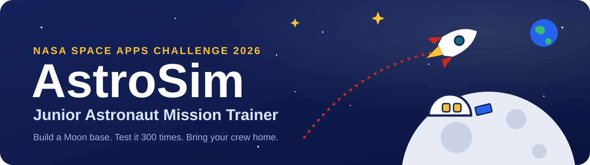
</p>

<p align="center">
  
  
  
  
  
  
</p>

<p align="center">
  <b>A free browser game for the NASA International Space Apps Challenge 2026</b><br>
  Challenge: <i>Build a Junior Astronaut Mission Trainer</i>
</p>

<p align="center">
  <a href="#-what-is-astrosim">About</a> ·
  <a href="#-screenshots">Screenshots</a> ·
  <a href="#-how-a-mission-works">How it works</a> ·
  <a href="#-the-3d-sim">3D Sim</a> ·
  <a href="#-real-nasa-data">NASA data</a> ·
  <a href="#-getting-started">Getting started</a> ·
  <a href="#-architecture">Architecture</a>
</p>

---

## 🚀 What is AstroSim?

Kids aged 7 to 12 (and older siblings, parents and teachers) run a **4-person Moon base at the lunar south pole for 30 days**. Every choice costs launch mass, power or crew time.

The game flies **300 test missions** and shows **how many crews out of every 100 came home**, why the others ran into trouble, and a replay of the hardest mission. Players can test their shielding against **real solar storms archived from NASA's DONKI database**, read **real astronaut findings from NASA OSDR**, and walk around a Moon base in a **hands-on 3D Sim**.

<table>
  <tr>
    <td align="center" width="25%">🧳<br><b>Pack the rocket</b><br><sub>Every panel, battery and shield has a weight</sub></td>
    <td align="center" width="25%">🧠<br><b>Set the rules</b><br><sub>Which machines switch off first</sub></td>
    <td align="center" width="25%">🎲<br><b>Fly 300 missions</b><br><sub>Different sun, dust, breakdowns and storms</sub></td>
    <td align="center" width="25%">🔍<br><b>Find out why</b><br><sub>Replay, cause chain and real NASA data</sub></td>
  </tr>
</table>

> No account, no download, no server, no tracking. It runs in any browser, on a phone too.

---

## 📸 Screenshots

<p align="center">
  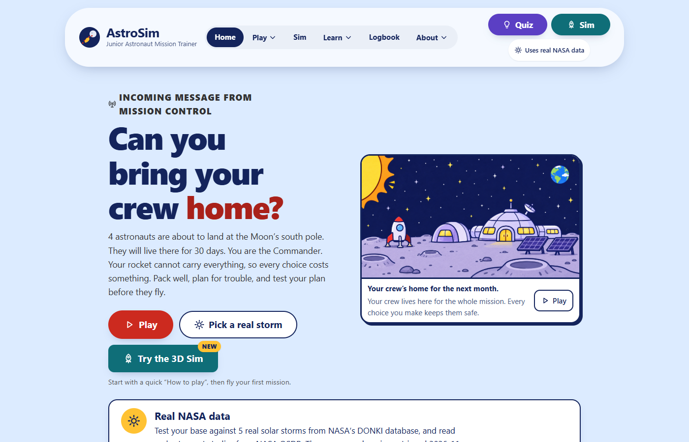
  <br><sub><b>Home:</b> the mission story, Play, a real storm, and the 3D Sim</sub>
</p>

<table>
  <tr>
    <td width="50%">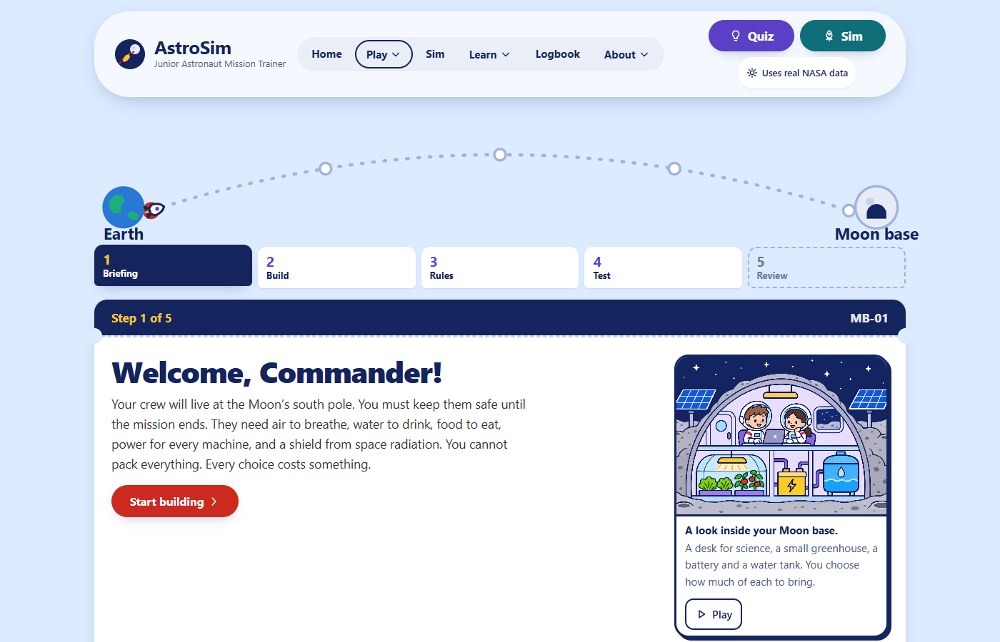<br><sub><b>Free build:</b> five steps from Earth to the Moon base</sub></td>
    <td width="50%">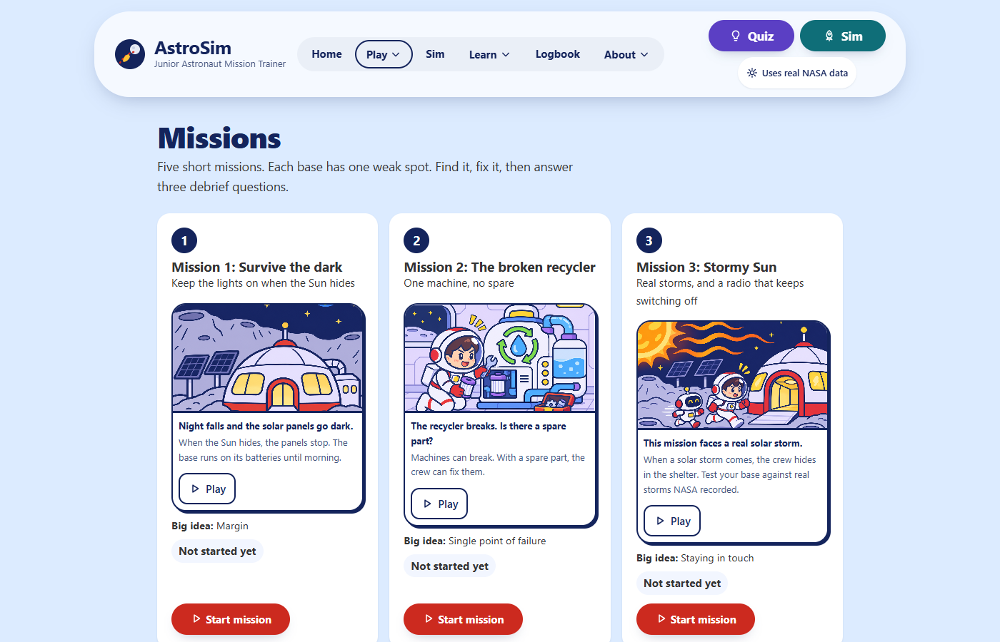<br><sub><b>Missions:</b> five guided missions, each with one big idea</sub></td>
  </tr>
  <tr>
    <td width="50%">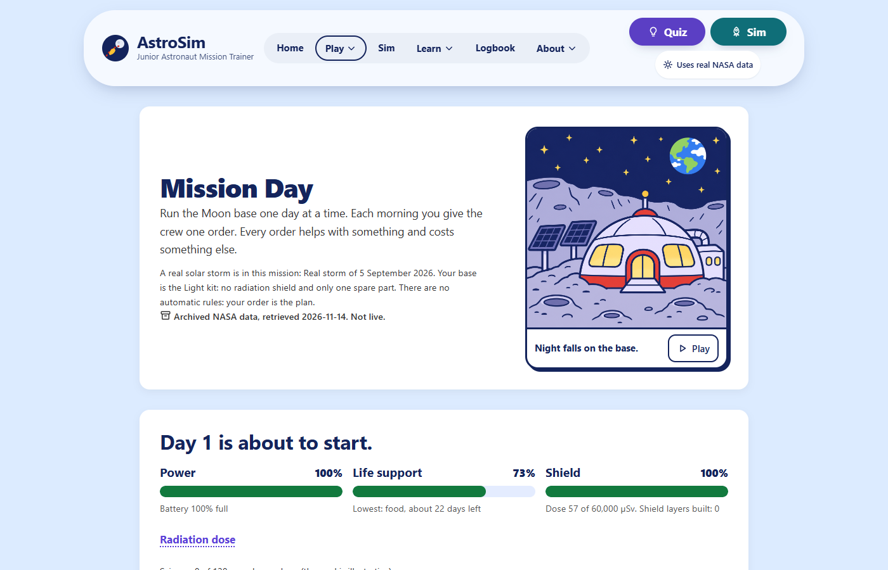<br><sub><b>Mission Day:</b> one order each morning, live meters</sub></td>
    <td width="50%">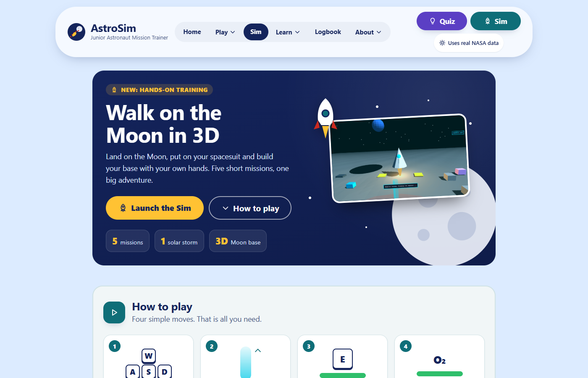<br><sub><b>3D Sim page:</b> how to play and five hands-on missions</sub></td>
  </tr>
  <tr>
    <td width="50%">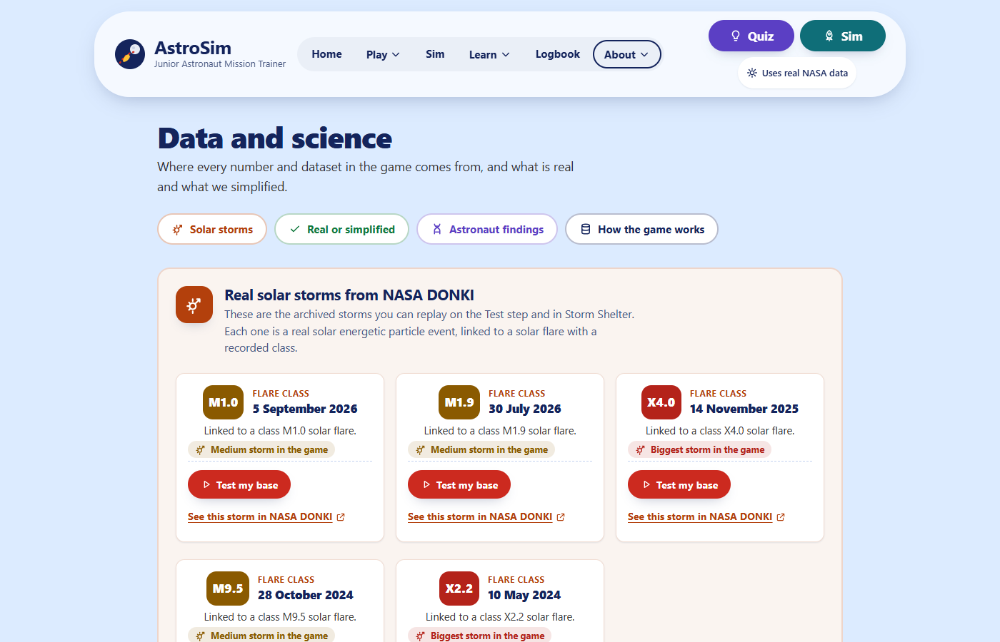<br><sub><b>Data and science:</b> every source as a flash card</sub></td>
    <td width="50%">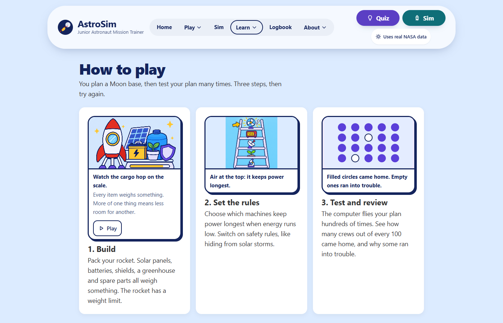<br><sub><b>How to play:</b> picture cards and a guided first mission</sub></td>
  </tr>
  <tr>
    <td width="50%">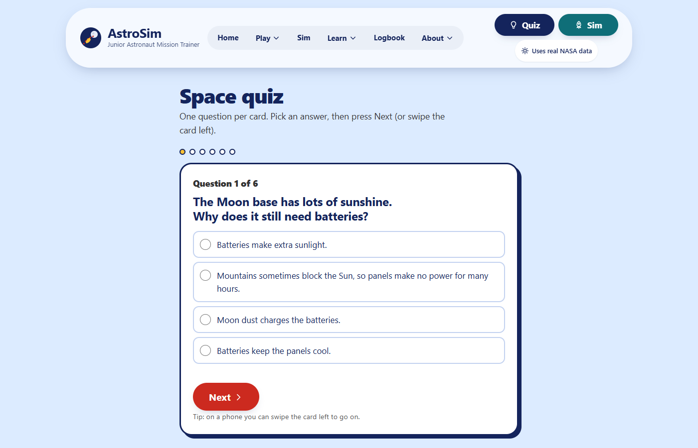<br><sub><b>Quiz:</b> quick space questions</sub></td>
    <td width="50%">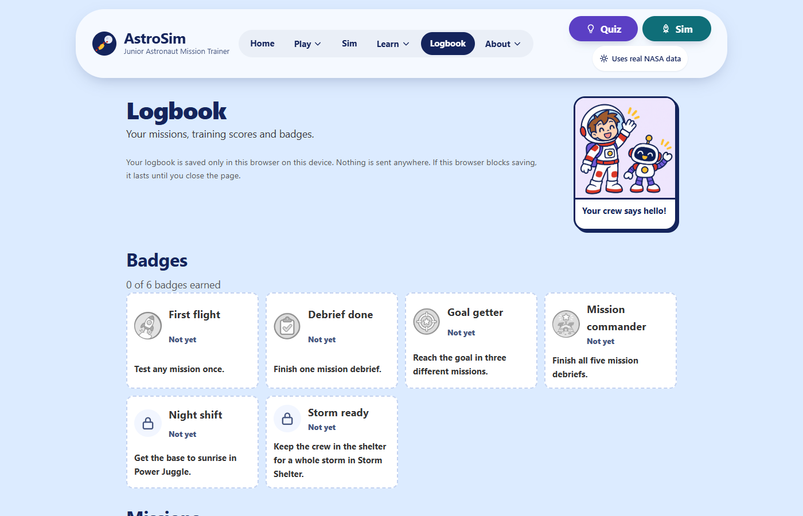<br><sub><b>Logbook:</b> badges and results, saved only in your browser</sub></td>
  </tr>
</table>

---

## 🧭 How a mission works

### The player's journey

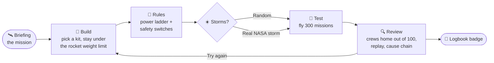

### Inside one test: 300 missions × 720 hours

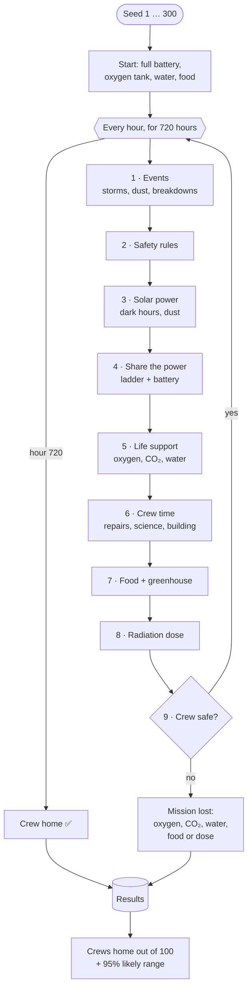

### Site map

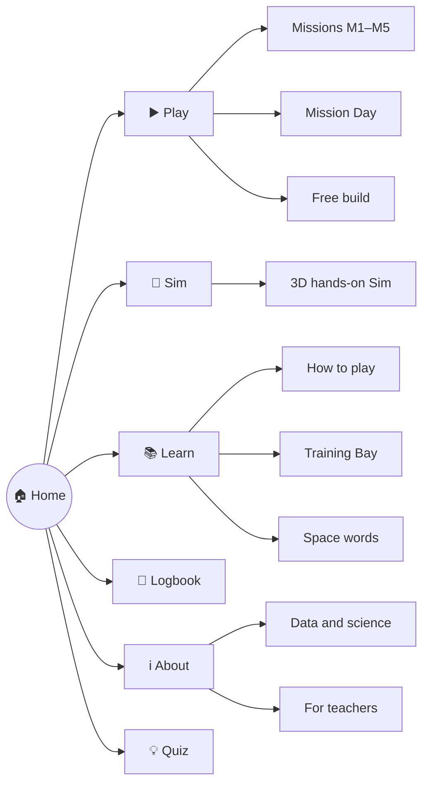

| Page | Address | What it is |
|---|---|---|
| Home | `#/` | The mission story, Play, a real storm, and the highlighted 3D Sim button |
| Missions | `#/missions` | Five guided missions (M1 to M5), each ending with a three-question debrief |
| Mission Day | `#/mission-day` | Play the mission one day at a time, choosing one order each morning |
| Free build | `#/free-build` | Briefing, Build, Rules, Test and Review with your own base |
| Sim | `#/sim` | The 3D Sim: how to play, its five missions with screenshots, and a Launch button |
| How to play | `#/how-to-play` | Picture cards and a guided first mission with coach tips |
| Training Bay | `#/training` | Practice games: Power Juggle and Storm Shelter |
| Space words | `#/words` | Every science word in plain language |
| Logbook | `#/logbook` | Badges, mission results and training scores, saved only in this browser |
| Data and science | `#/data` | Every archived storm, the OSDR findings, what is real and what we simplified, and every number with its source |
| For teachers | `#/teachers` | A lesson plan, the big ideas, the pre/post quiz and scenario codes |
| Quiz | `#/quiz` | A short space quiz |

---

## 🌙 The 3D Sim

A hands-on 3D training page (`public/sim/index.html`). Land on the Moon, then complete five missions with your own astronaut.

<table>
  <tr>
    <td width="33%">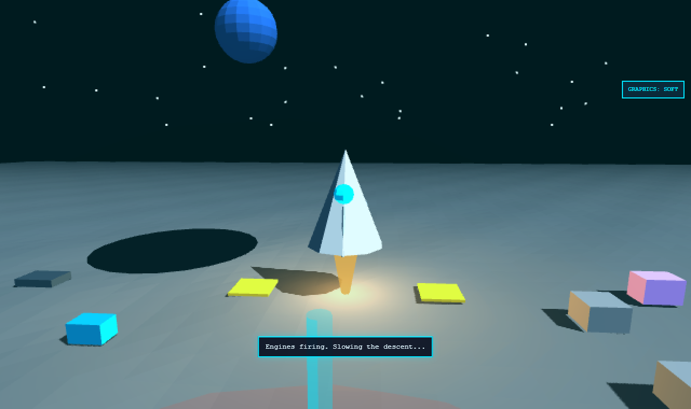<br><sub><b>Landing</b></sub></td>
    <td width="33%">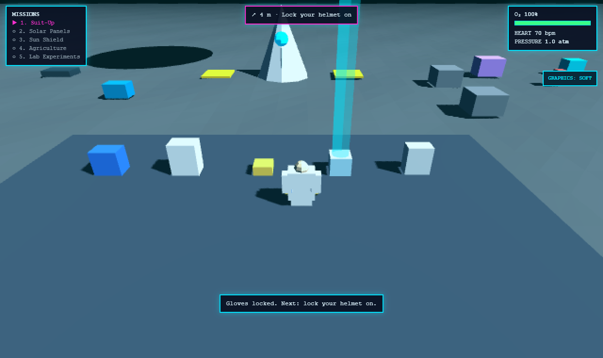<br><sub><b>1 · Suit-Up</b></sub></td>
    <td width="33%">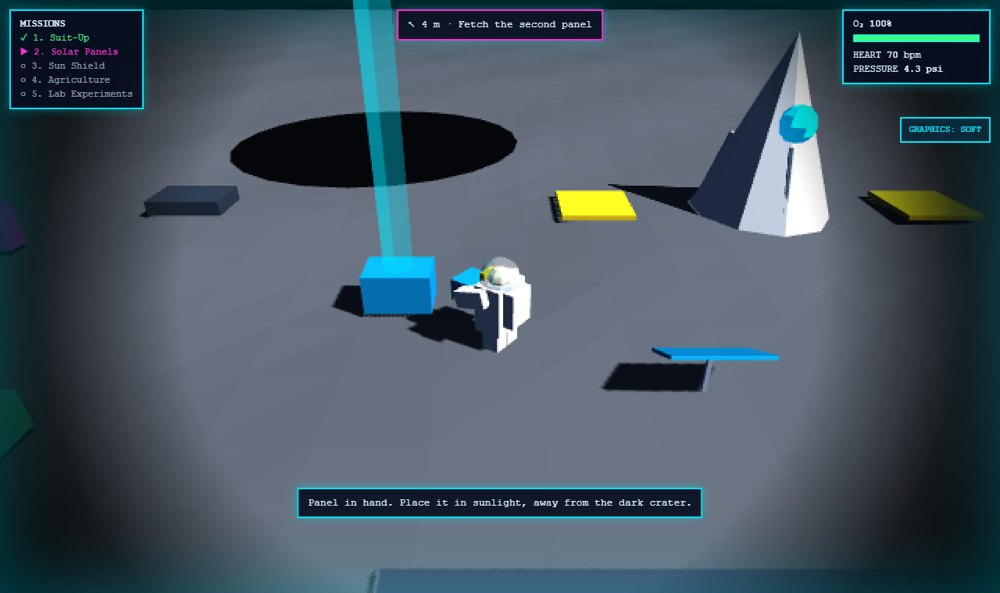<br><sub><b>2 · Solar Panels</b></sub></td>
  </tr>
  <tr>
    <td width="33%">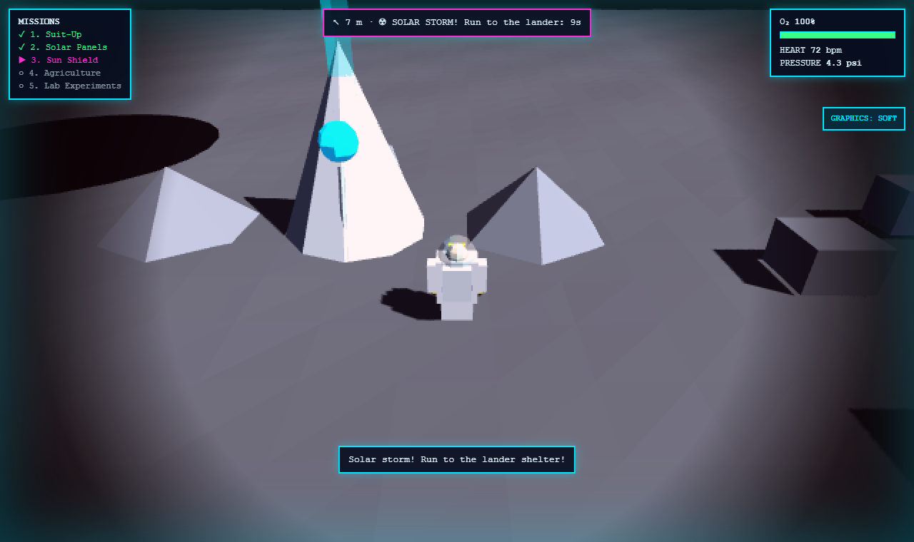<br><sub><b>3 · Sun Shield + solar storm</b></sub></td>
    <td width="33%">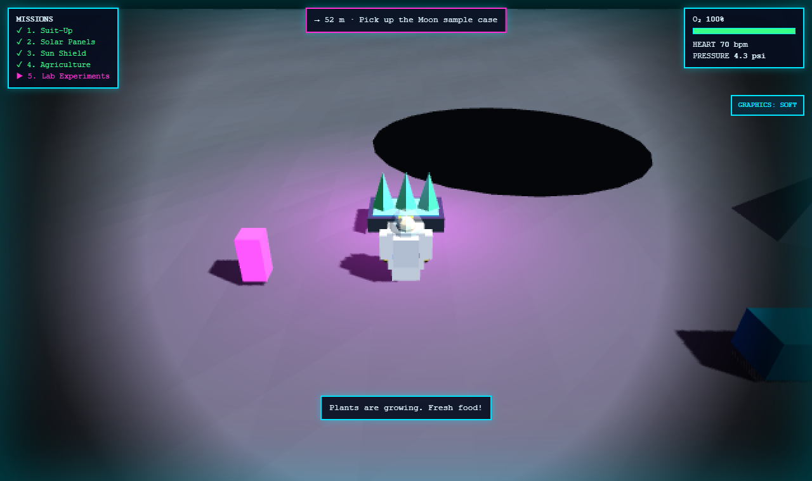<br><sub><b>4 · Agriculture</b></sub></td>
    <td width="33%">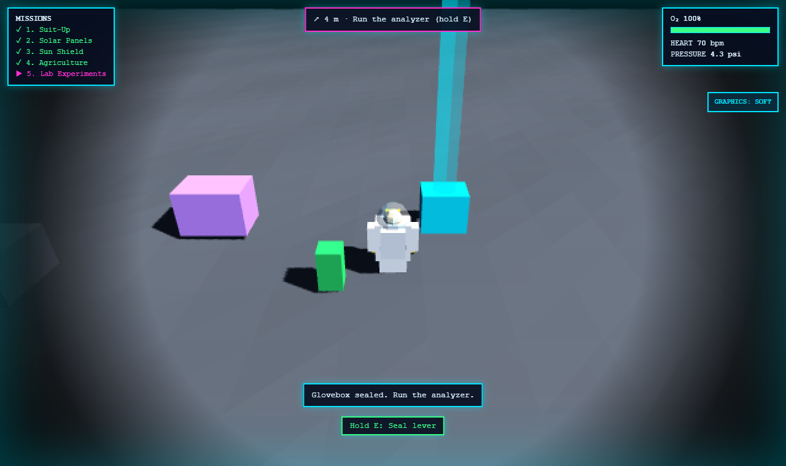<br><sub><b>5 · Lab Experiments</b></sub></td>
  </tr>
</table>

**Controls:** move with <kbd>W</kbd> <kbd>A</kbd> <kbd>S</kbd> <kbd>D</kbd> or the arrow keys, follow the blue beam, and hold <kbd>E</kbd> to do each job. On a phone, use the on-screen buttons.

> The 3D Sim loads its 3D library (three.js) from cdnjs, so it needs an internet connection. Everything else works offline.

---

## ⚖️ The trade-offs it teaches

| | Trade-off |
|---|---|
| 🧳 **Mass** | Every panel, battery, shield layer or spare takes rocket space from something else. |
| 🔋 **Power** | Mountains block the Sun for hours; batteries carry the base through. Machines lower on your ladder switch off first. |
| 💧 **Air and water** | The oxygen maker splits water; recyclers save water; breakdowns without spares can end a mission. |
| 🛡️ **Radiation** | Shields and the shelter cut the dose; hiding stops science and building. |
| 📡 **Communication** | Storm warnings from Earth arrive by radio. Switching the radio off saves power but costs warnings and repair help. A radio message takes about 1.3 seconds to reach the Moon and 3 to 22 minutes to reach Mars. |

---

## 🛰️ Real NASA data

| Dataset | Used for |
|---|---|
| **NASA DONKI** space weather database (S12) | 5 real solar storms (2024 to 2026) with their linked flare class, for Real Storm Replay |
| **NASA OSDR**, Open Science Data Repository (S13) | 5 real studies shown as "Real astronaut finding" cards |
| Chang'e-4 lunar surface dose (S02), NASA ECLSS (S04), Sabatier (S05), south pole sunlight (S03, S09) | Simulation numbers |

All data is archived in [`data/`](data) and labelled on screen *"Archived NASA data, retrieved &lt;date&gt;. Not live."* What is real and what we simplified is in [`docs/DATA_USED.md`](docs/DATA_USED.md). Every number and its source is in [`data/params.json`](data/params.json) and behind every **Why this number?** button.

---

## 🛠️ Getting started

Requires **Node.js 22** or newer.

```bash
git clone https://github.com/jaineesh-kumar/NASA_APP_Challenge.git
cd NASA_APP_Challenge
npm ci            # install the locked dependencies
npm run dev       # open http://localhost:3000
```

<details>
<summary><b>All scripts</b></summary>

```bash
npm run typecheck   # TypeScript strict
npm run lint        # ESLint, zero warnings
npm run test        # Vitest: engine, golden files, UI, accessibility
npm run build       # production bundle in dist/
npm run preview     # serve the production bundle locally

# Refresh the NASA data (developer machine only)
npm run data:fetch      # DONKI storms -> data/donki_archive.json (DEMO_KEY, or NASA_API_KEY)
npm run data:osdr       # OSDR studies -> data/osdr_cards.json
npm run golden:update   # only after an approved model change
```

Never commit an API key. `.env` is git-ignored; see `.env.example`.
</details>

<details>
<summary><b>Deploying</b></summary>

The build in `dist/` is static and self-contained.

- **GitHub Pages:** run `npm run build` and publish `dist/` (the Vite `base` is relative, so sub-paths work).
- **Vercel:** framework preset Vite, build command `npm run build`, output directory `dist`. No environment variables or server are needed.
</details>

---

## 🏗️ Architecture

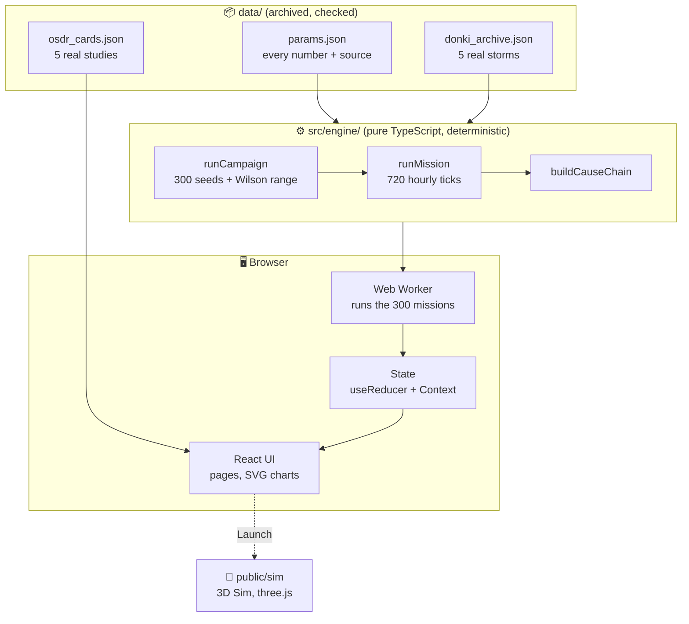

```
src/
├── engine/     simulation: power, life support, food, crew, radiation, events, rules, Monte Carlo
├── worker/     runs a 300-mission test off the main thread
├── state/      store, campaign hook, progress, scenario codes
├── content/    every word on screen (copy, missions, quiz, concepts, media)
└── ui/         screens, components, styles
public/         pictures, video clips, the 3D Sim, favicon
data/           archived NASA data and the parameter file
tests/          engine, golden files, UI and accessibility tests (239)
```

- **Deterministic:** the same seed and choices always give the same result, locked by golden files.
- **Private:** no accounts, analytics, trackers or cookies; only progress is saved, in your own browser.
- **Secure:** no network requests at runtime; the production build ships a strict Content-Security-Policy.
- **Accessible:** keyboard controls with visible focus, readable contrast, plain language, reduced motion when asked.

More detail: [`docs/ARCHITECTURE.md`](docs/ARCHITECTURE.md) · [`docs/MODEL_CARD.md`](docs/MODEL_CARD.md) · [`docs/DATA_USED.md`](docs/DATA_USED.md) · [`docs/SOURCES.md`](docs/SOURCES.md)

---

## 🧪 What we simplified

- The mission moves in one-hour steps; every crew member uses the same amount of air, water and food.
- Many numbers are illustrative game choices (marked ASSUMPTION and labelled "illustrative" on screen).
- A replayed storm arrives at mission hour 300, and its strength depends only on its flare class letter.
- No spacewalk radiation, crew tiredness, detailed heating, or orbit and relay model.

---

## 📚 Scientific citations

<details>
<summary><b>Show all sources</b></summary>

- **S01:** Anderson, Ewert & Keener (2018). Life Support Baseline Values and Assumptions Document (BVAD), NASA/TP-2015-218570/REV1.
- **S02:** Zhang, S. et al. (2020). First measurements of the radiation dose on the lunar surface. Science Advances 6(39), eaaz1334.
- **S03:** Ross, A. et al. (2021). Towers on the Peaks of Eternal Light: Quantifying the Available Solar Power. arXiv:2102.11766.
- **S04:** NASA. Environmental Control and Life Support System (ECLSS) fact sheet.
- **S05:** NASA. Sabatier Carbon Dioxide Reduction Assembly development.
- **S06:** NASA (2011). Probabilistic Risk Assessment Procedures Guide, NASA/SP-2011-3421.
- **S08:** Frontiers in Space Technologies (2024). Assessment of the physical and psychological aspects of the current life support system on the ISS.
- **S09:** Wood, C. (2017). Peaks of "Eternal" Light. Sky & Telescope.
- **S10:** ECLSS sizing reference (secondary source citing NASA-STD-3001 and BVAD).
- **S12:** NASA CCMC, DONKI space weather database (api.nasa.gov/DONKI).
- **S13:** NASA Open Science Data Repository (OSDR).
- **S14:** Official challenge page, "Build a Junior Astronaut Mission Trainer".
</details>

---

## 👩‍🚀 Author & submission

| | |
|---|---|
| **Author / Lead Developer** | Jaineesh Kumar |
| **GitHub** | [@jaineesh-kumar](https://github.com/jaineesh-kumar) |
| **Email** | `jaineesh.makwana001@gmail.com` |
| **Event** | NASA International Space Apps Challenge 2026 |
| **Challenge** | *Build a Junior Astronaut Mission Trainer* |

<p align="center"><sub>Made for young space explorers. Pictures and clips are illustrations, not real NASA imagery.</sub></p>
