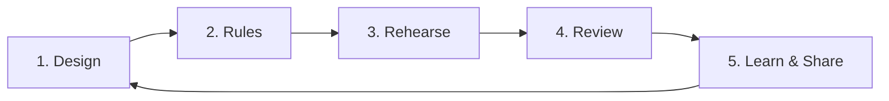
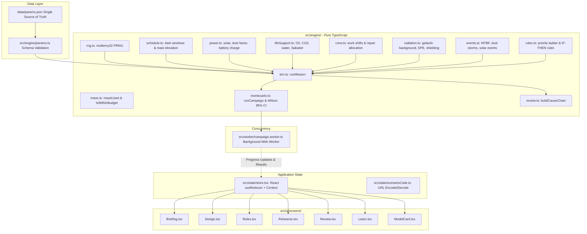

# 🌕 Moonbase Margin

> **Junior Astronaut Mission Trainer**  
> *A deterministic lunar outpost life support, power, and margin simulation game for ages 10–16.*  
> **NASA International Space Apps Challenge 2026**

[](https://www.typescriptlang.org/)
[](https://react.dev/)
[](https://vitejs.dev/)
[](https://vitest.dev/)
[](LICENSE)
[](#-privacy--security)

---

## 🛰️ Project Brief & Overview

**Moonbase Margin** places junior astronauts and students in the role of lead systems flight directors managing a 4-person lunar expedition over a critical 30-day (720 hourly ticks) mission to the Moon's south pole.

Unlike simplified sci-fi games where oxygen and electricity are inexhaustible, **Moonbase Margin** teaches authentic aerospace systems engineering:
- **Mass has a cost:** Every extra solar array, battery unit, or water loop module consumes limited lander payload budget.
- **Dark windows are unforgiving:** Lunar topography creates extended periods of darkness where solar arrays generate zero power, demanding rigorous battery sizing and thermal management.
- **Life Support is a closed loop:** Crew respiration consumes oxygen and generates carbon dioxide; urine and hygiene moisture must be recaptured and purified; water electrolysis produces breathing air, while Sabatier catalytic reactors recycle carbon dioxide back into water.
- **Failures happen stochastically:** Dust storms diminish solar generation, solar particle events (SPE) irradiate the habitat, and mechanical subsystems break down based on mean time between failures (MTBF).

Through an iterative engineering loop—**Design, Rules, Rehearse, Review, and Learn**—students build confidence in probabilistic risk assessment (PRA), mass margins, and life-critical triage.

---

## 🎯 Our Aim & Mission

1. **Authentic STEM Learning:** Ground space education in verified aerospace literature rather than science fiction, using NASA's *Life Support Baseline Values and Assumptions Document* (BVAD NASA/TP-2015-218570) and lunar surface radiation data from *Science Advances*.
2. **Systems-Thinking & Trade-offs:** Show students that there is no single "perfect" design—every engineering decision requires balancing mass constraints, power budgets, risk tolerance, and scientific return.
3. **Transparent Science ("Why This Number?"):** Every parameter visible in the application features an interactive provenance inspector showing its baseline value, units, source citation, confidence rating, and engineering rationale.
4. **Accessible, Zero-Barrier Simulation:** 100% client-side, responsive, offline-capable, keyboard-navigable (WCAG 2.1 AA compliant), and runnable on any modern web browser without accounts, server setup, or downloads.

---

## 🔄 Core Gameplay & Simulation Loop



### 1. Design (Mass Budgeting & Hardware Allocation)
- **Select Site:** 
  - *Shackleton Ridge:* ~90% annual illumination, two 36-hour dark windows, 600 kg initial water reservoir.
  - *Faustini Crater Rim:* ~70% annual illumination, three 72-hour dark windows, 900 kg initial water reservoir (ice cold trap).
- **Manage Mass Budget:** Allocate a strict 120 Mass Unit (mu) lander payload limit across:
  - Solar Photovoltaic Panels (1–8 units)
  - Mast Elevation Towers (Level 0–3 to reduce shadow duration)
  - Battery Storage Modules (1–12 units, 20 kWh each)
  - Water Recovery Loop (Base 70% or Tier 1 Brine Processor 98%)
  - Oxygen Loop (Open loop or Tier 1 Sabatier Catalytic Reactor 50%)
  - Hydroponic Greenhouse Modules (0–3 units for supplemental nutrition)
  - Regolith Radiation Shielding Layers (0–3 built layers, 40 crew-hours each)
  - Subsystem Spare Components (0–2 spares for scrubber, O2 generator, water loop, power array)

### 2. Rules (Priority Shedding & Automated Triggers)
- **6-Load Priority Ladder:** Rank which outpost subsystems receive power during brownouts:
  $$\text{Life Support} \rightarrow \text{Thermal Control} \rightarrow \text{Comms} \rightarrow \text{Greenhouse} \rightarrow \text{Science} \rightarrow \text{Construction}$$
- **Automated IF-THEN Emergency Rules:** Construct up to 5 automated contingency triggers:
  - *IF* Battery < 20% *THEN* Shed Thermal
  - *IF* SPE Storm Warning *THEN* Order Crew to Shelter
  - *IF* Component Fails *THEN* Prioritize Repairs Over Routine Shifts
  - *IF* Dark Window Within 6 Hours *THEN* Run Greenhouse on Low Power
  - *IF* O2 Days Remaining < 3 *THEN* Pause Science Research

### 3. Rehearse (Monte Carlo Simulation Campaign)
- Executes 300 stochastic 720-hour mission simulations off the main browser thread inside a dedicated Web Worker.
- Calculates **Mission Survival Probability** and **Science Mission Success Rate** backed by rigorous 95% Wilson score confidence intervals.
- Evaluates 5th and 95th safety percentiles for battery depth-of-discharge, oxygen margins, and cumulative radiation dose.

### 4. Review (Deep Causal Diagnostics)
- **Worst-Run Hour-by-Hour Timeline:** Scrub and play through the 720-hour trajectory of the worst simulated scenario.
- **Root-Cause Causal Chain:** Automatically traces failures from root environmental triggers through cascading system deprivations to loss conditions:
  $$\text{Dust Storm} \xrightarrow{} \text{Solar Depleted} \xrightarrow{} \text{Battery Empty} \xrightarrow{} \text{Scrubber Unpowered} \xrightarrow{} \text{Hypercapnia Loss}$$
- **Mass vs. Risk Scatter Plot:** Hand-crafted SVG visualization mapping each tested configuration's mass efficiency against its survival rate.

### 5. Learn & Scenario Codes
- **Guided Missions M1–M3:** Progressive scaffolding missions teaching power balancing, closed-loop water recovery, and radiation shielding.
- **Astronaut Readiness Quiz:** 6-question interactive assessment testing key engineering principles.
- **Shareable Scenario Codes:** URL-safe `MM1-...` encoded payloads allowing students and educators to share exact outpost designs and contingency rules with a single click.

---

## 🏗️ System Architecture



---

## ⚙️ Simulation Logic & Hourly Tick Operations

Every mission is modeled as 720 discrete 1-hour ticks. Inside `src/engine/sim.ts`, each tick processes in strict, immutable order:

```mermaid
sequenceDiagram
    autonumber
    participant Sim as runMission()
    participant Evt as events.ts
    participant Rules as rules.ts
    participant Power as power.ts
    participant Life as lifeSupport.ts
    participant Crew as crew.ts
    participant Rad as radiation.ts
    participant Check as Loss Check

    Sim->>Evt: 1. Generate seeded stochastic events (SPE, dust, component MTBF)
    Sim->>Rules: 2. Evaluate IF-THEN rules based on t-1 state
    Sim->>Power: 3. Calculate solar irradiance & available energy (genKw + batteryKwh)
    Sim->>Power: 4. Allocate power across 6 loads; update battery charge/discharge
    Sim->>Life: 5. Process ECLSS (O2 electrolysis, CO2 scrubbing, water reclamation, Sabatier)
    Sim->>Crew: 6. Allocate productive crew hours (repairs, greenhouse, science, shielding)
    Sim->>Life: 7. Deduct crew caloric intake & harvest greenhouse yields
    Sim->>Rad: 8. Compute hourly radiation dose (background GCR + SPE storm attenuation)
    Sim->>Check: 9. Test deficit counters (hypoxia, dehydration, hypercapnia, starvation, dose)
```

### Governing Mathematical Equations

#### 1. Solar Generation & Battery Dynamics
$$P_{\text{gen}} = N_{\text{panels}} \times P_{\text{panel}} \times S_{\text{sun}} \times F_{\text{dust}} \times F_{\text{array}}$$
- $S_{\text{sun}} = 0$ inside a dark window, else $1.0$.
- $F_{\text{dust}} = 0.5$ during an active dust storm, else $1.0$.
- If $P_{\text{gen}} \ge P_{\text{supplied}}$:
  $$E_{\text{battery}}(t) = \min\left(E_{\text{cap}},\, E_{\text{battery}}(t-1) + (P_{\text{gen}} - P_{\text{supplied}}) \times \eta_{\text{charge}}\right)$$
- If $P_{\text{gen}} < P_{\text{supplied}}$:
  $$E_{\text{battery}}(t) = E_{\text{battery}}(t-1) - (P_{\text{supplied}} - P_{\text{gen}})$$

#### 2. Closed-Loop ECLSS Mass Balances
- **Oxygen Consumption & Electrolysis:**
  $$m_{\text{O2, need}} = N_{\text{crew}} \times \frac{0.84\,\text{kg/day}}{24}$$
  $$m_{\text{H2O, electrolysis}} = m_{\text{O2, produced}} \times 1.125\,\text{kg H}_2\text{O / kg O}_2$$
- **Water Reclamation & Sabatier Recovery:**
  $$m_{\text{H2O, gross}} = N_{\text{crew}} \times \frac{2.50\,\text{kg/day}}{24}$$
  $$R_{\text{water}} = \begin{cases} 0.98 & \text{Tier 1 (Brine Processor)} \\ 0.70 & \text{Base Loop} \end{cases}$$
  $$m_{\text{H2O, Sabatier}} = 0.50 \times m_{\text{O2, need}} \times 1.125$$

#### 3. Radiation Attenuation
$$\text{Dose}_{\text{hourly}} = \left(\text{Rate}_{\text{GCR}} + \text{Rate}_{\text{SPE}}\right) \times \left(1 - \text{Layers} \times 0.20\right) \times F_{\text{shelter}}$$
- $F_{\text{shelter}} = 0.30$ when astronauts retreat into the storm shelter.

---

## 📁 Repository Structure

```
├── .github/workflows/ci.yml       # GitHub Actions CI (Typecheck, Lint, Test, Build)
├── data/
│   └── params.json                # Single source of truth for all 62 parameters
├── docs/
│   ├── ARCHITECTURE.md            # Detailed subsystem data flow and sequence diagrams
│   ├── MODEL_CARD.md              # Parameter transparency registry & simplifications
│   ├── SOURCES.md                 # Scientific source citations (S01–S11)
│   ├── DECISIONS.md               # Architecture Decision Records (ADRs)
│   ├── STATUS.md                  # Development progress log
│   └── PLAYTEST.md                # Playtest feedback and mission balance notes
├── src/
│   ├── engine/                    # Pure TypeScript Engine (0 DOM/React dependencies)
│   │   ├── types.ts               # Core domain interfaces and types
│   │   ├── params.ts              # Schema validation and typed parameter getters
│   │   ├── rng.ts                 # Deterministic 32-bit mulberry32 PRNG
│   │   ├── schedule.ts            # Solar illumination and dark window schedules
│   │   ├── power.ts               # Solar irradiance, dust storms, and battery balance
│   │   ├── lifeSupport.ts         # O2 generator, Sabatier, water recovery, CO2 scrubber
│   │   ├── food.ts                # Caloric reserves and hydroponic greenhouse yields
│   │   ├── crew.ts                # Crew shift priorities, repairs, and shielding construction
│   │   ├── radiation.ts           # GCR dose, SPE solar storms, and regolith attenuation
│   │   ├── events.ts              # Stochastic draws for MTBF component breakdowns
│   │   ├── rules.ts               # Priority ladder allocator & IF-THEN rule engine
│   │   ├── mass.ts                # Lander payload mass meter calculations
│   │   ├── sim.ts                 # Deterministic 720-hour mission execution loop
│   │   ├── montecarlo.ts          # 300-run campaign aggregator and Wilson 95% CIs
│   │   ├── review.ts              # Automated causal chain diagnostics and concept hints
│   │   └── index.ts               # Frozen engine public API
│   ├── worker/
│   │   └── campaign.worker.ts     # Dedicated Web Worker for Monte Carlo campaigns
│   ├── state/
│   │   ├── store.tsx              # React Context & useReducer state management
│   │   └── scenarioCode.ts        # Shareable MM1-... scenario encoder/decoder
│   ├── ui/
│   │   ├── components/            # Reusable UI controls (Ladder, Meter, Charts, Modals)
│   │   ├── screens/               # Briefing, Design, Rules, Rehearse, Review, Learn, ModelCard
│   │   └── styles/                # WCAG AA tokens.css and base.css
│   ├── content/                   # User-facing text, guided missions M1-M3, and quiz questions
│   ├── App.tsx                    # Main app shell & navigation router
│   └── main.tsx                   # React 19 application entry point
├── tests/
│   ├── engine/                    # Deterministic unit tests for every engine module
│   ├── golden/                    # Bit-for-bit golden run validation (seeds 1, 2, 3)
│   ├── state/                     # Scenario code encoding/decoding tests
│   └── ui/                        # Screen interaction & accessibility unit tests
├── index.html
├── package.json
├── tsconfig.json
└── vite.config.ts
```

---

## 🚀 Getting Started

### Prerequisites
- **Node.js**: v20+ or v22 LTS
- **npm**: v10+

### Installation & Local Development

```bash
# 1. Clone repository
git clone https://github.com/jaineesh-kumar/NASA_APP_Challenge.git
cd NASA_APP_Challenge

# 2. Install dependencies
npm install

# 3. Start local development server (runs at http://localhost:3000)
npm run dev
```

### Verification & Testing

```bash
# Execute full suite of 105 automated unit and golden tests
npm test

# Run strict TypeScript type check
npm run typecheck

# Run ESLint validation
npm run lint

# Build optimized production bundle
npm run build

# Preview production build locally
npm run preview
```

---

## 🚢 Deployment

### Deploying to GitHub Pages
1. Build the production application:
   ```bash
   npm run build
   ```
2. The compiled static artifacts in `dist/` are entirely self-contained (HTML5, JS, CSS, SVG).
3. Deploy the `dist/` directory via GitHub Actions or the `gh-pages` branch.

### Deploying to Vercel
1. Link your repository in the Vercel dashboard or run:
   ```bash
   npx vercel
   ```
2. Framework Preset: **Vite**
3. Build Command: `npm run build`
4. Output Directory: `dist`
5. No backend databases, environment secrets, or server runtimes are required.

---

## 🔒 Privacy & Security

- **100% Client-Side:** All simulations, Monte Carlo calculations, and scenario decoders run entirely in the player's web browser.
- **Zero Trackers or Telemetry:** No analytics, advertising cookies, or third-party trackers.
- **No Network Requests at Runtime:** Operates completely offline once loaded.
- **Protected Secrets:** No credentials, API tokens, or server environments are included or exposed.

---

## 🔬 Scientific Citations & Acknowledgements

- **S01:** Anderson, M., Ewert, M., & Keener, J. (2018). *Life Support Baseline Values and Assumptions Document (BVAD)*. NASA/TP-2015-218570/REV1.
- **S02:** Zhang, S. et al. (2020). *First measurements of the radiation dose on the lunar surface*. Science Advances, 6(39), eaaz1334.
- **S03:** Ross, A. et al. (2021). *Towers on the Peaks of Eternal Light: Quantifying Available Solar Power*. arXiv:2102.11766.
- **S04:** NASA (2025). *Environmental Control and Life Support System (ECLSS) Fact Sheet*.
- **S05:** NASA. *Sabatier Carbon Dioxide Reduction Assembly Development*.
- **S06:** NASA (2011). *Probabilistic Risk Assessment Procedures Guide for NASA Managers and Practitioners*. NASA/SP-2011-3421.
- **S08:** Frontiers in Space Technologies (2024). *Assessment of Physical and Psychological Aspects of ECLSS on ISS*.
- **S09:** Wood, C. (2017). *Peaks of "Eternal" Light*. Sky & Telescope.
- **S10:** ECLSS Sizing Reference (Secondary source citing NASA-STD-3001 and BVAD).

---

## 👨‍🚀 Author & Submission Details

- **Author / Lead Developer:** Jaineesh Kumar
- **GitHub:** [@jaineesh-kumar](https://github.com/jaineesh-kumar)
- **Email:** `jaineesh.makwana001@gmail.com`
- **Project:** NASA International Space Apps Challenge 2026
- **Challenge Track:** *Build a Junior Astronaut Mission Trainer*
- **Repository:** [NASA_APP_Challenge](https://github.com/jaineesh-kumar/NASA_APP_Challenge.git)
