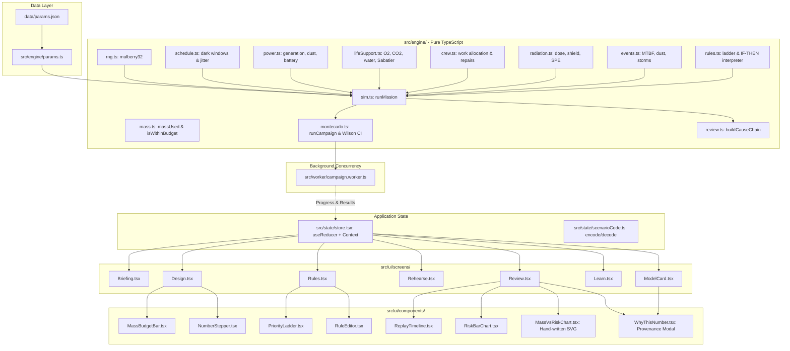
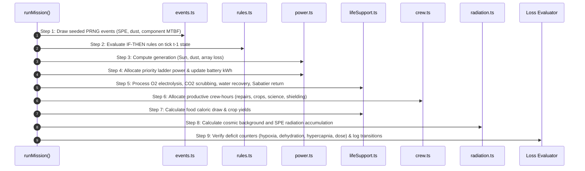

# Moonbase Margin: Architecture & Data Flow

> Specification Version: 0.1.0  
> System: Pure TypeScript Engine + React 19 UI + Web Worker Monte Carlo Pipeline

---

## 1. System Overview

Moonbase Margin separates the simulation engine completely from the UI layer to maintain strict determinism, testability, and replay fidelity:

1. **Engine Layer (`src/engine/`):** Pure functional TypeScript. Zero React or DOM dependencies. Zero runtime imports. All domain constants are loaded via `params.ts` from `data/params.json`. Uses standard 32-bit `mulberry32` PRNG for bit-for-bit replayability.
2. **Web Worker Layer (`src/worker/`):** Offloads multi-second 300-run Monte Carlo campaigns from the UI thread, broadcasting periodic progress messages to keep the user interface responsive.
3. **State Management (`src/state/`):** Built on React `useReducer` and Context (`AppStoreProvider`). Handles screen navigation, hardware selections, priority ladders, rule creation, and scenario code encode/decode.
4. **UI Screen & Component Layer (`src/ui/`):** Accessible (WCAG 2.1 AA 4.5:1 contrast, visible focus rings, keyboard navigable) screens for Briefing, Design, Rules, Rehearsal, Review, Learn, and Model Card.

---

## 2. Block Architecture & Module Diagram

---

## 3. Hourly Simulation Tick Data Flow (720 Ticks)

Within `src/engine/sim.ts`, each tick advances deterministically through fixed steps:

---

## 4. Scenario Code Format (`src/state/scenarioCode.ts`)

Shareable scenario codes serialize the outpost design and rules into a URL-safe format:

- **Format:** `MM<version>-<base64url_json_payload>`
- **Validation:** String length capped at 2048 characters. Schema validated on decode; corrupt payloads, unknown load IDs, or out-of-range hardware settings throw typed `EngineError`.
